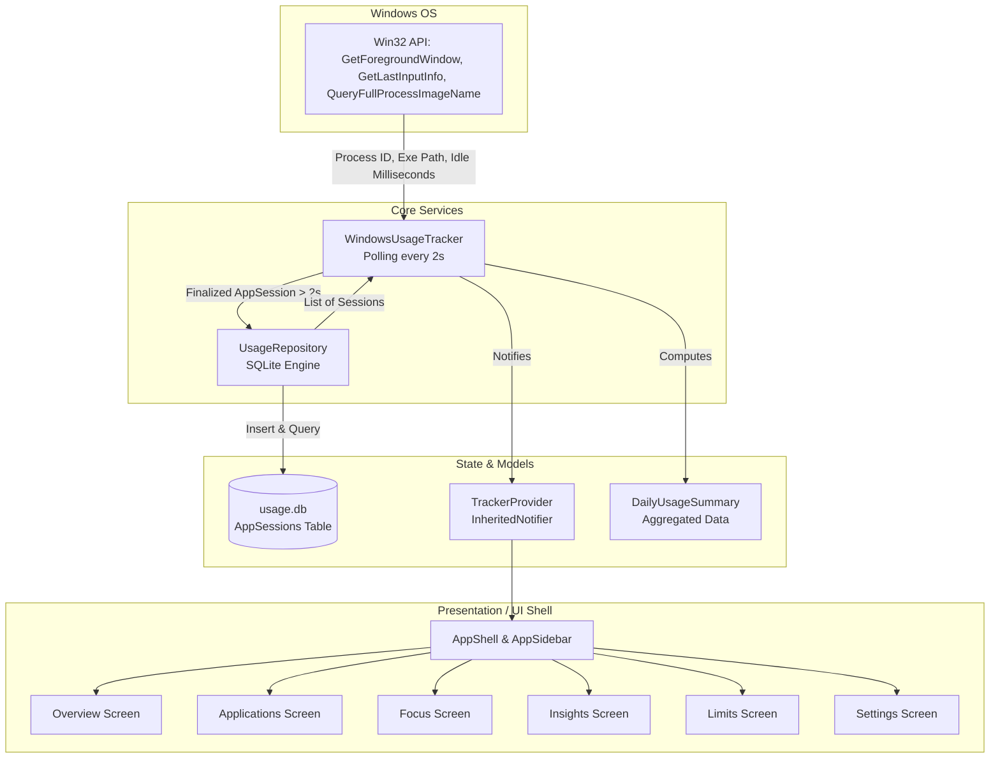

# Balance — Windows Digital Wellbeing & Screen Time Tracker
> Comprehensive Architectural and Feature Documentation

---

## 1. Executive Summary

**Balance** (`DigitalWelbeing`) is a native desktop digital wellbeing, productivity analytics, and time-tracking application built with **Flutter Desktop for Windows**. 

Inspired by operating system-level screen time managers (such as iOS Screen Time and Android Digital Wellbeing), Balance passively monitors active desktop usage in real time, aggregates foreground application activity into a local SQLite database, and presents clear insights through a clean pastel dashboard.

### Core Value Proposition
* **Privacy-First & Local-Only:** All tracking data is collected locally via Windows API and stored directly on the machine in an SQLite database—no cloud sync or external data transmission.
* **Low Overhead Tracking:** Uses native Win32 FFI calls to inspect the foreground window and detect user idle states with minimal CPU overhead.
* **Calm & Modern Aesthetic:** Employs a bespoke design system featuring soft pastel tones, clear typographic hierarchy (Google Fonts *Inter*), Lucide icons, and responsive layouts.

---

## 2. Technology Stack & Dependencies

| Layer | Technology | Details / Purpose |
| :--- | :--- | :--- |
| **Framework** | Flutter Desktop (Windows) | Dart SDK `^3.10.7`, Material 3 enabled |
| **Native Interop** | `win32: ^6.4.0` & `ffi: ^2.2.0` | Direct Windows API calls (C-interop) for window handles & input idle time |
| **Database** | `sqflite_common_ffi: ^2.4.0+3` | SQLite engine for desktop via FFI (`usage.db`) |
| **Data Visualization** | `fl_chart: ^1.2.0` | Custom 24-hour activity timelines and weekly bar charts |
| **Icons & Typography** | `lucide_icons: ^0.257.0`, `google_fonts: ^8.2.1` | Clean vector iconography and Inter typeface |
| **Utilities** | `intl: ^0.19.0`, `path: ^1.9.1` | Date/time formatting and cross-platform path resolution |

---

## 3. System Architecture & Data Flow



### Flow Lifecycle
1. **Initialization (`lib/main.dart`):**
   * SQLite FFI factory initialized.
   * `UsageRepository` instantiates `usage.db`.
   * `WindowsUsageTracker` initializes, computes today's summary, and starts a 2-second periodic timer.
   * App UI wrapped in `TrackerProvider` (`InheritedNotifier<WindowsUsageTracker>`).
2. **Polling Loop (`_checkForegroundWindow`):**
   * **Inactivity Check:** Calls Win32 `GetLastInputInfo()`. If inactive for `> 2 minutes`, current active session is immediately finalized and saved.
   * **Foreground Window Inspection:** Queries `GetForegroundWindow()`, resolves the process ID via `GetWindowThreadProcessId()`, opens process with `OpenProcess()`, and extracts binary path using `QueryFullProcessImageName()`.
   * **Session Finalization:** When the active window switches or user idles, sessions longer than 2 seconds are inserted into the SQLite database.
3. **Reactive Re-Aggregation:**
   * After any session is committed, `_refreshSummary()` re-queries the day's records, groups active durations per app, bins 24 hourly buckets, and calls `notifyListeners()`, immediately updating the UI.

---

## 4. File-by-File Breakdown

### 4.1 Application Core (`lib/app/`)
* **[`app.dart`](lib/app/app.dart):**
  Defines `BalanceApp` and the `TrackerProvider` inherited widget. Manages system light/dark theme delegation.
* **[`theme/app_colors.dart`](lib/app/theme/app_colors.dart):**
  Defines specific design palette colors:
  * Light: Periwinkle (`#DDE8FF`), Lavender (`#EAE1FC`), Mint (`#DDF3E6`), Peach (`#FBE7D7`), Primary Blue (`#637FC2`).
  * Dark: Dark background (`#171922`), Dark surface (`#222530`), muted pastel accents.
  * `AppThemeColors`: A `ThemeExtension` allowing semantic color access across themes (`colors.cardBlue`, `colors.primaryAccent`).
* **[`theme/app_spacing.dart`](lib/app/theme/app_spacing.dart):**
  Design tokens for margins (`xs: 4`, `sm: 8`, `md: 16`, `lg: 24`, `xl: 32`, `xxl: 48`) and border radii (`cardRadius: 28`, `innerRadius: 16`).
* **[`theme/app_theme.dart`](lib/app/theme/app_theme.dart):**
  Exports `lightTheme` and `darkTheme` ThemeData objects configuring typography, Material 3 schemes, and theme extensions.

### 4.2 Models & Services (`lib/core/`)
* **[`models/app_session.dart`](lib/core/models/app_session.dart):**
  Represents an active contiguous session of a desktop application:
  * `id`: Auto-incrementing primary key.
  * `appName`: Clean process name (e.g. "Code", "Chrome", "Spotify").
  * `exePath`: Absolute path to the executable.
  * `startTime` & `endTime`: Timestamps stored as epoch milliseconds.
  * `duration`: Computed difference between `endTime` and `startTime`.
* **[`models/usage_data.dart`](lib/core/models/usage_data.dart):**
  Defines analytics transfer models:
  * `AppUsageData`: Aggregated total time, daily limit, and percentage share.
  * `DailyUsageSummary`: Total active time, goal time, breaks, hourly activity (24 buckets), and lists of applications.
  * Includes `generateDemoData()` helper.
* **[`services/usage_repository.dart`](lib/core/services/usage_repository.dart):**
  SQLite manager using `sqflite_common_ffi`. Creates table `AppSessions` and handles:
  * `insertSession(AppSession session)`
  * `getSessionsForDay(DateTime date)`
* **[`services/windows_usage_tracker.dart`](lib/core/services/windows_usage_tracker.dart):**
  Native tracking engine implementing `ChangeNotifier`. Manages Win32 FFI pointers, polling timers, idle thresholds, session commits, and daily summary calculations.

### 4.3 Shared UI Widgets (`lib/core/widgets/`)
* **[`app_shell.dart`](lib/core/widgets/app_shell.dart):**
  Navigation container hosting `AppSidebar` and using `AnimatedSwitcher` with subtle slide/fade transitions for view switching.
* **[`app_sidebar.dart`](lib/core/widgets/app_sidebar.dart):**
  Left desktop navigation bar featuring brand header and navigation items: Overview, Applications, Focus, Insights, Limits, Settings.
* **[`screen_time_ring.dart`](lib/core/widgets/screen_time_ring.dart):**
  Animated dual-ring circular progress widget displaying active time (hours + minutes) against the daily goal (e.g., 8 hours).
* **[`activity_chart.dart`](lib/core/widgets/activity_chart.dart):**
  24-hour timeline bar chart built with `fl_chart`. Highlights peak hours with hover tooltips displaying exact minutes.
* **[`app_usage_tile.dart`](lib/core/widgets/app_usage_tile.dart):**
  Application row displaying icon container, title, proportional progress bar, and formatted duration string.
* **[`rounded_metric_card.dart`](lib/core/widgets/rounded_metric_card.dart):**
  Consistent 28px rounded container card with elevation box-shadows.
* **[`page_header.dart`](lib/core/widgets/page_header.dart):**
  Standard page banner supporting title, description, and contextual calendar date.

---

## 5. Feature-by-Feature Analysis

### 5.1 Overview Screen (`lib/features/overview/overview_screen.dart`)
* **Tracking Status Banner:**
  Displays whether background tracking is active, paused, or encountered an error. Features a one-click **Pause / Resume** toggle.
* **Hero Screen Time Card:**
  Displays the animated `ScreenTimeRing` alongside status badges ("Live Data" vs "No Data Yet").
* **Responsive Multi-Column Layout:**
  * Displays a side-by-side split grid on wide monitors (> 900px wide).
  * Collapses gracefully into a single-column stacked view on compact windows.
* **Metric Quick Cards:**
  Shows Focus Time and Breaks Taken metrics in soft pastel tiles.
* **Top 5 Applications:**
  Quick list of the 5 most heavily used applications today.

### 5.2 Applications Screen (`lib/features/applications/applications_screen.dart`)
* Full, unconstrained list of every application launched and active during the current day.
* Displays proportional bar indicators showing relative usage percentages across all apps.
* Empty state handler with placeholder illustration when no data exists yet.

### 5.3 Focus Screen (`lib/features/focus/focus_screen.dart`)
* 25-minute Pomodoro-style focus countdown timer.
* Glowing ring shadow indicator when active.
* Features Start, Pause, and Reset controls.

### 5.4 Insights Screen (`lib/features/insights/insights_screen.dart`)
* Weekly usage bar chart (`fl_chart`) plotting Monday through Sunday active hours.
* Daily Average, Most Used Category, and Focus Score metric cards.

### 5.5 Limits Screen (`lib/features/limits/limits_screen.dart`)
* Card list showcasing daily application time limits with threshold warnings (turns red when usage exceeds 80%).
* "Add Limit" action button.

### 5.6 Settings Screen (`lib/features/settings/settings_screen.dart`)
* Configurable toggles for "Launch on Startup", "Notifications", and "Dark Mode".
* Interactive slider for adjusting "Idle Timeout" between 1 and 15 minutes.

---

## 6. Functional Status: What It CAN Do vs. What It CANNOT Do

| Capability | Status | Implementation Details / Gaps |
| :--- | :---: | :--- |
| **Active Foreground Process Tracking** | **Functional** | Queries Win32 API via Dart FFI every 2 seconds. Identifies executable name and full file path. |
| **System Inactivity / Idle Detection** | **Functional** | Measures mouse/keyboard idle ticks via `GetLastInputInfo`. Breaks sessions when idle. |
| **SQLite Session Persistence** | **Functional** | Inserts completed sessions into local `usage.db` using `sqflite_common_ffi`. |
| **Live Overview Aggregation** | **Functional** | Calculates real-time total active time, 24h timeline bins, and top 5 apps for the current day. |
| **Tracking Pause / Resume Controls** | **Functional** | Pauses the timer and finalizes active sessions from the Overview banner. |
| **Focus Countdown Timer** | **Functional** | 25-minute interactive timer with start, pause, and reset actions. |
| **Multi-Platform Support** | **Cannot Do** | Strictly coupled to Windows via `package:win32`. Cannot track on macOS, Linux, or mobile. |
| **Settings Wiring to Logic** | **Cannot Do** | Settings toggles and idle slider are UI state only; they do not alter tracker properties or theme mode. |
| **App Limit Enforcement** | **Cannot Do** | Limits screen is mock UI. No warnings, process termination, or app blocking occurs. |
| **Dynamic Historical Insights** | **Cannot Do** | Insights weekly chart displays hardcoded numbers rather than querying past days from SQLite. |
| **Focus Mode Logging & Blocking** | **Cannot Do** | Focus timer does not record sessions into the database or block distracting applications. |
| **Extracting Real App Icons** | **Cannot Do** | Uses generic `Icons.apps` fallback; does not extract `.ico` resources from executable binaries. |
| **System Tray / Background Daemon** | **Cannot Do** | Closing the window exits the application and stops all tracking. |
| **Historical Calendar Navigation** | **Cannot Do** | Overview only shows "Today"; no date picker is implemented to review previous days. |

---

## 7. Database Schema Reference

The local database is stored at `<DatabasesPath>/usage.db` and managed by [`UsageRepository`](lib/core/services/usage_repository.dart).

```sql
CREATE TABLE AppSessions (
    id INTEGER PRIMARY KEY AUTOINCREMENT,
    appName TEXT NOT NULL,
    exePath TEXT NOT NULL,
    startTime INTEGER NOT NULL,  -- Epoch milliseconds
    endTime INTEGER NOT NULL     -- Epoch milliseconds
);

CREATE INDEX IF NOT EXISTS idx_sessions_time ON AppSessions (startTime, endTime);
```

---

## 8. Development & Setup Guide

### Prerequisites
* Windows 10/11 (64-bit)
* Flutter SDK (`^3.10.7` or later)
* Visual Studio with **Desktop development with C++** workload installed

### Running the Application
```powershell
# Navigate to project folder
cd d:\fluttering_flutter\DigitalWelbeing

# Fetch packages
flutter pub get

# Launch on Windows Desktop
flutter run -d windows
```

### Running Automated Tests
The repository includes automated database and repository tests in `test/widget_test.dart`:
```powershell
flutter test
```

---

## 9. Recommended Future Roadmap

1. **Phase 1: Wire Up Settings & Theme Management**
   * Connect `SettingsScreen` idle slider to `WindowsUsageTracker._idleThreshold`.
   * Bind dark mode toggle to a root `ValueNotifier<ThemeMode>`.
2. **Phase 2: App Limits Engine**
   * Create an `AppLimits` SQLite table.
   * Implement threshold notifications using `local_notifier` or Win32 toast APIs when limits are reached.
3. **Phase 3: System Tray & Auto-Startup**
   * Integrate `tray_manager` and `window_manager` so closing minimizes to the Windows taskbar tray.
   * Add Windows Registry startup entry (`HKCU\Software\Microsoft\Windows\CurrentVersion\Run`).
4. **Phase 4: True Weekly & Monthly Analytics**
   * Implement range aggregation queries in `UsageRepository` (e.g., `getWeeklySummary(DateTime weekStart)`).
   * Dynamically populate `InsightsScreen` with authentic weekly averages.
5. **Phase 5: Native App Icon Caching**
   * Use Windows Shell `ExtractIconExW` via FFI to extract and cache high-resolution `.ico` files as PNG byte streams.
